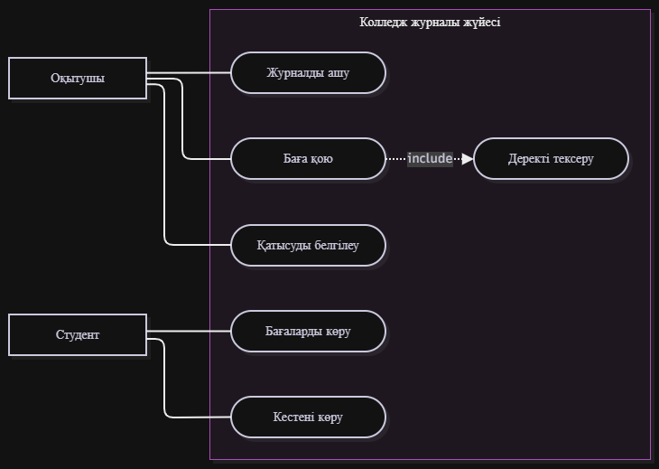
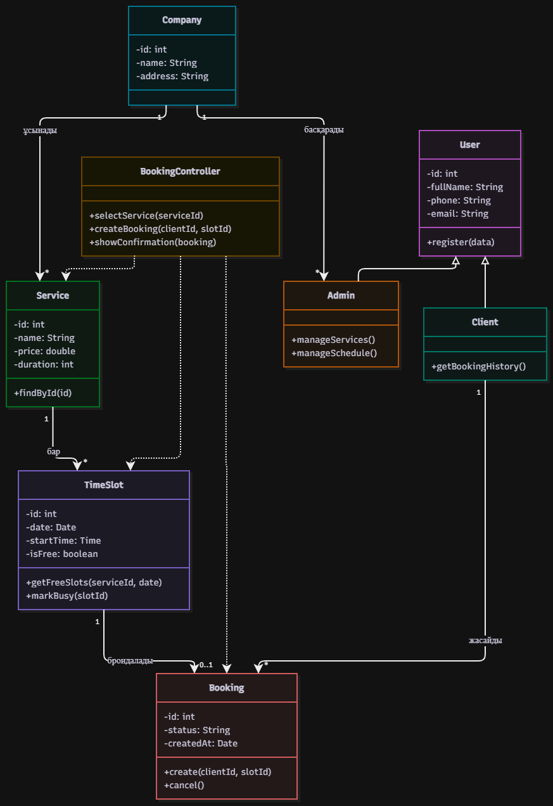
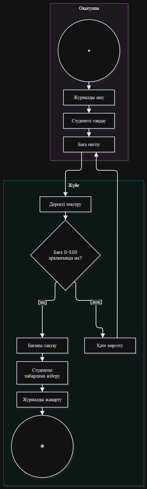
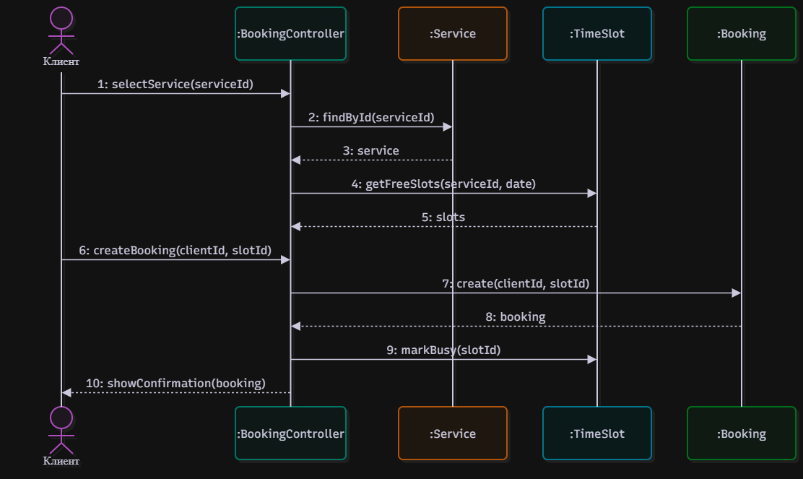

# Клиенттерді сервистік компанияларға онлайн жазу үшін мобильді қосымша

Автор: Жұмабай Дамир, ВТ(КИ)к-24-1б

## Мәселе
Сервистік компанияларға (салон, автосервис, клиника) жазылу көбіне телефон арқылы жүреді: клиент бос уақытты біле алмайды, әкімші жазбаларды қолмен жүргізеді, қателер мен қайталанған жазбалар шығады. Мобильді қосымша клиентке бос уақытты көріп, онлайн жазылуға, ал компанияға жазбаларды бір жерде басқаруға мүмкіндік береді.

## Акторлар
- Клиент
- Компания әкімшісі

## Талаптар
### Функционалдық
### Функционалдық емес

## Диаграммалар
### 1. Use Case

### 2. Class

### 3. Activity: Онлайн жазылу

### 4. Sequence: Онлайн жазылу

